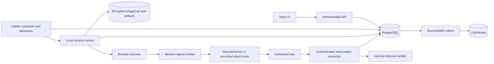

# Architecture and operational contracts

PostgreSQL is authoritative. Redis dispatch and ClickHouse analytics may be unavailable without deleting acknowledged definitions or observations. Alembic migrations add project ownership to legacy targets/workflows/runs and add independent profile, session, attempt, batch, schedule, proxy, experiment and artifact records. Existing data remains in the default project with its original provenance.

Docker Compose runs the data services. The application and browsers run on the host. Each live browser uses a session-scoped local egress broker.

## Services and ownership

The API handles authentication, project permissions, validated commands and reads. It does not start a scheduler. The dedicated scheduler holds a PostgreSQL advisory leadership lock, computes APScheduler triggers, materializes occurrences transactionally, admits bounded work, reaps leases and delivers outboxes. Every occurrence has a unique schedule/version/time key. Queue publication and analytics retries cannot create extra research samples.

The local standard and vendor runners claim admitted work. Browser interception and the session broker enforce navigation scope and account for requests and transport. Browser startup uses a sanitized child environment where the adapter supports it. Vendor DNS resolution is recorded as an additional trust boundary.

Admission uses global, project, batch, and target limits, plus configured adapter seats and proxy availability. The hard global active limit is 500. Local throughput depends on worker capacity and host resources. Target start rates are independent of concurrent capacity. Instrumented targets also respect `ABRL_ADSCORE_RATE_LIMIT`, which defaults to 30 per minute.

## Profiles and recovery

A browser profile is durable state, not a platform account. Every launch chooses fresh or persistent behavior. Persistent launches lock the profile row, increment its ownership epoch and acquire a filesystem lock. Snapshots require confirmed shutdown; encrypted immutable generations bind metadata and content through authenticated encryption and a database checksum. Restoration requires matching adapter, exact browser version, OS and architecture. No cross-OS portability is assumed.

Heartbeats cover startup, execution and persistence. Losing a lease stops execution and closes its route. Lease expiry quarantines the profile and reserves its proxy binding: it never transfers ownership merely because a timer elapsed. A stale worker cannot release a newer epoch. Owner recovery requires an explicit termination confirmation, the current ownership epoch and audited evidence. SIGTERM drains active work; uncertain shutdown/save remains quarantined.

Each batch persists allocation items independently: known profile errors retain successful allocations, and idempotent creation retry cannot recreate an existing session. Unresolved allocation failures prevent completion and remain in reliability denominators. A session has logical attempts, separate workflow and operational outcomes, ground truth and an activity timeline. Known pre-action connection failure may recover within the pinned policy; authentication/quota errors pause inventory. No negative detector verdict is retried for a better result. An uncertain externally visible action is never automatically replayed.

## Scheduling

One-time, interval and five-field cron schedules use IANA zones. Numeric cron weekdays are rejected to avoid POSIX/APScheduler ambiguity; use `mon` through `sun`. Nonexistent DST wall times are skipped; only the first repeated wall time executes. Overlap is skip, queue-one, or allow within admission limits. Missed occurrences coalesce at most one execution within the configured grace (default 15 minutes). Catch-up work is bounded independent of outage duration. Pausing differs from natural expiration so a final queued occurrence remains valid within grace.

Schedule templates have immutable revisions that pin the target, workflow, proxy policy, and session settings. Updating a schedule creates a revision. Existing executions retain their snapshots. Changing a site registration invalidates its earlier launch revision. Old simulated schedules and schedules using the retired Lab fixture are paused until an operator saves a valid live revision and resumes them.

## Evidence, exports and artifacts

The site connector binds verified observations to the active session, attempt, and ownership epoch. Idempotency detects conflicting payload reuse. AdScore code 0 is Clean. Browser-only and simulated histories retain their original provenance.

Historical experiment records and frozen report snapshots remain in storage. New batches save a server-generated seed when one is omitted. Idempotent launch retries reuse the original batch and allocation order.

New live batches and schedules default to screenshot, console, and bounded JavaScript capture. Screenshots mask secret inputs and password fields. Console artifacts redact known secret values and context tokens. Downloads require project authorization, and retained artifacts use authenticated encryption, checksum verification, and automatic expiry. Manual viewer frames are transient and cleared on completion.

## Observability

`/api/v1/fleet/metrics` derives counts and queue age from PostgreSQL. A dedicated `ABRL_METRICS_TOKEN` can authenticate local metrics collection. Structured logs avoid request query credentials. Optional OTLP exports support tracing. Session and legacy event outboxes retry independently, and ClickHouse reads deduplicate event sequences.
