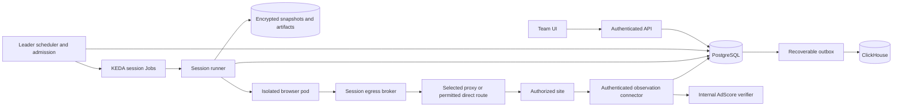

# Architecture and operational contracts

PostgreSQL is authoritative. Redis dispatch and ClickHouse analytics may be unavailable without deleting acknowledged definitions or observations. Alembic migrations add project ownership to legacy targets/workflows/runs and add independent profile, session, attempt, batch, schedule, proxy, experiment and artifact records. Existing data remains in the default project with its original provenance.

Local workers use the same ownership and execution contracts without Kubernetes.
Browser pods do not receive database or proxy-provider credentials.

## Services and ownership

The API handles authentication, project permissions, validated commands and reads. It does not start a scheduler. The dedicated scheduler holds a PostgreSQL advisory leadership lock, computes APScheduler triggers, materializes occurrences transactionally, admits bounded work, reaps leases and delivers outboxes. Every occurrence has a unique schedule/version/time key. Queue publication and analytics retries cannot create extra research samples.

The local session runner claims admitted work. A cloud KEDA Job owns one assignment and provisions separate browser and broker pods. The runner holds DB/object credentials; the browser cannot connect to the database or Internet directly. Three independent capabilities separate browser control, broker control and browser proxy access. Per-session network policies prevent access to another session's broker/CDP endpoint. A broker starts paused until browser policies are attached. Vendor DNS resolution is recorded as an additional trust boundary.

Admission uses global/project/batch/target limits, configured adapter seats and proxy availability. The hard global active limit is 500. Target start rates are independent of concurrent capacity; instrumented targets additionally respect `ABRL_ADSCORE_RATE_LIMIT` (30/minute unless explicitly configured). Cloud resource requests and maximum node counts remain finite even without a monetary cap.

## Profiles and recovery

A browser profile is durable state, not a platform account. Every launch chooses fresh or persistent behavior. Persistent launches lock the profile row, increment its ownership epoch and acquire a filesystem lock. Snapshots require confirmed shutdown; encrypted immutable generations bind metadata and content through authenticated encryption and a database checksum. Restoration requires matching adapter, exact browser version, OS and architecture. No cross-OS portability is assumed.

Heartbeats cover startup, execution and persistence. Losing a lease stops execution and closes its route. Lease expiry quarantines the profile and reserves its proxy binding: it never transfers ownership merely because a timer elapsed. A stale worker cannot release a newer epoch. Owner recovery requires an explicit termination confirmation, the current ownership epoch and audited evidence. SIGTERM drains active work; uncertain shutdown/save remains quarantined.

Each batch persists allocation items independently: known profile errors retain successful allocations, and idempotent creation retry cannot recreate an existing session. Unresolved allocation failures prevent completion and remain in reliability denominators. A session has logical attempts, separate workflow and operational outcomes, ground truth and an activity timeline. Known pre-action connection failure may recover within the pinned policy; authentication/quota errors pause inventory. No negative detector verdict is retried for a better result. An uncertain externally visible action is never automatically replayed.

## Scheduling

One-time, interval and five-field cron schedules use IANA zones. Numeric cron weekdays are rejected to avoid POSIX/APScheduler ambiguity; use `mon` through `sun`. Nonexistent DST wall times are skipped; only the first repeated wall time executes. Overlap is skip, queue-one, or allow within admission limits. Missed occurrences coalesce at most one execution within the configured grace (default 15 minutes). Catch-up work is bounded independent of outage duration. Pausing differs from natural expiration so a final queued occurrence remains valid within grace.

Reusable session templates have their own immutable revisions. Launches pin a template revision and reject silent configuration drift; name and request identity remain launch-specific. Definitions pin target/workflow/proxy revisions and session configuration. Updating an experiment or schedule creates a revision; existing executions retain their snapshots. Disabling or changing site authorization blocks affected live work.

## Evidence, exports and artifacts

Server verification binds observations to the active session/attempt/epoch. Idempotency detects conflicting payload reuse. Browser callback success is not verification. AdScore code0 is Clean; unknown vendor codes remain intact. The controlled fixture uses a versioned verified-Clean gate. Browser-only histories are never reclassified.

Experiment runs persist a seeded permutation across every declared group and allocation, including reserved positions for failed creations. Run-wide concurrency defaults to one. Run reports retain matched target/workflow/version/phase/evidence strata and immutable snapshot checksums. Research comparisons stratify actual environments, use logical trials as sample units, and keep simulated evidence separate. Repeated profile/participant samples use cluster analysis; participant identity is recorded for genuine human controls. Missing runtime identity prevents qualification. PDF/HTML/CSV/JSON exports share an immutable result snapshot and checksum.

Screenshot/console capture is opt-in. Secret inputs/password fields are masked; known secret values and context tokens are redacted from console artifacts. Artifacts are authenticated-encrypted before storage, project-authorized on download, checksum verified and expired by retention jobs. Raw signatures are never written to artifacts or observations. Manual viewer frames are bounded transient session metadata, excluded from list responses, outboxes and reports, and cleared on completion.

## Observability

`/api/v1/fleet/metrics` derives counts and queue age from PostgreSQL, fixing process-local worker metric visibility. A dedicated `ABRL_METRICS_TOKEN` authenticates cloud scraping. Prometheus/cAdvisor collect host and workload resources; CNPG/ClickHouse expose service metrics. Structured logs avoid request query credentials. Optional OTLP exports support deployment tracing. Session and legacy event outboxes retry independently; ClickHouse reads use deduplicated sequences (`FINAL` or equivalent).

Live cloud capacity, single-node recovery, synchronous durability and disaster-recovery RPO/RTO are claims requiring the deployment rehearsals in the delivery ledger, not conclusions from local unit tests.
